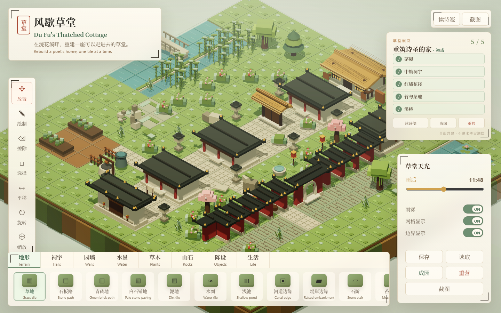

# 风歇草堂 · 草堂营建

> 基于公开等距营建模板二次开发的 3D 杜甫草堂营建游戏，定位为研究/教学可玩原型。

在线试玩（上传后）：

```text
https://lhd257257-commits.github.io/dufu-garden/
```



## 内容

- 20×20 草堂布局：中轴祠宇—柴门—茅屋、红墙花径、竹林溪桥；
- 七类专属 3D 构件：正门、中轴祠宇、柴门、茅屋、少陵碑亭、红墙段/转角、红墙月洞门；
- 五项营建规制与三首杜诗诗笺；
- 构件栏、规制面板、诗笺界面、保存/读取、移动端布局；
- 全部建筑/植物/地形为 Three.js 程序化几何，不使用 PUBG 或上游模板的官方素材。

## 技术

- Three.js
- Vite（构建时 `base: './'`，支持 GitHub Pages 子目录）
- 原生 JavaScript / Canvas UI
- 生产构建 + 桌面/移动端浏览器验证

## 本地预览

```bash
python -m http.server 8000
```

打开：

```text
http://127.0.0.1:8000/dufu-garden/
```

## 授权状态（重要）

上游模板 `dreamers505/Dream-Garden-Jiangnan` **没有 LICENSE 文件**。本目录仅作为研究/教学原型展示，不作为已授权商业产品发布。

- 如果上游作者已给予许可，请保留书面授权；
- 如果未取得许可，请勿商业发行、售卖或声称拥有完整版权；
- 详细来源见 [`ATTRIBUTION.md`](ATTRIBUTION.md)。

## 不包含

- 原始 20GB 数据；
- 上游模板的官方地图/素材；
- 任何账号、token 或私密数据。
