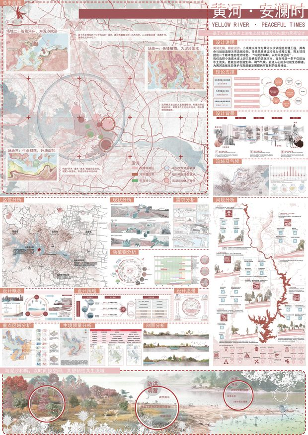

# 刘昊东 · 作品集

静态单页作品集，无框架、无构建步骤，可直接部署到 GitHub Pages。

- 页面：`index.html`
- 样式：`assets/css/style.css`
- 交互：`assets/js/main.js`（滚动出现 + 图片放大）
- 图片：`assets/img/`（1500px 大图用于放大查看，`w/` 下是 620px 缩略图）
- 简历：`assets/resume.pdf`（页面上「下载简历」按钮指向它）

> 本仓库不含任何在建项目的图纸与资料。德阳五洲广场、德阳轨道站点、成都三圣乡科研基地、雅安黄龙民宿四项因保密要求未收录，页面中以一段说明代替。

---

## 一、本地预览

任选一种：

```bash
# 方式 1：Python（推荐，最接近线上效果）
cd portfolio
python -m http.server 8000
# 浏览器打开 http://localhost:8000

# 方式 2：直接双击 index.html
```

---

## 二、三步上线（最快）

1. GitHub 网页新建**空**仓库，仓库名填 `<用户名>.github.io`（不勾 README、不勾 .gitignore）
2. 在本目录运行：

   ```powershell
   cd D:\作品\portfolio
   .\push.ps1 <用户名> <用户名>.github.io
   ```

   首次推送会弹出浏览器让你登录 GitHub，授权后自动推完。
3. 等 1–2 分钟，访问 `https://<用户名>.github.io/`

本地仓库和首个提交（`5381b8d`）已经建好，`push.ps1` 只负责设置远程和推送，不会改动文件。
## 三、部署到 GitHub Pages

### 方案 A：账号主页仓库（域名最短）

1. 在 GitHub 新建仓库，仓库名必须是 `<你的用户名>.github.io`
2. 把本文件夹里的**全部文件**上传到仓库根目录（不要多套一层文件夹）
3. 等待 1–2 分钟，访问 `https://<你的用户名>.github.io`

### 方案 B：普通仓库

1. 新建仓库，例如 `portfolio`
2. 上传全部文件到根目录
3. 进入仓库 **Settings → Pages**
   - Source 选 `Deploy from a branch`
   - Branch 选 `main`，目录选 `/ (root)`，保存
4. 1–2 分钟后访问 `https://<你的用户名>.github.io/portfolio/`

### 用命令行上传（可选）

```bash
cd portfolio
git init
git add .
git commit -m "init portfolio"
git branch -M main
git remote add origin https://github.com/<你的用户名>/<仓库名>.git
git push -u origin main
```

---

## 四、以后怎么改

| 想改什么 | 改哪里 |
| --- | --- |
| 文字、作品说明、奖项 | `index.html`（每件作品是一个 `<article class="work">`） |
| 颜色、字号、间距 | `assets/css/style.css` 顶部的 `:root` 变量 |
| 换作品图 | 替换 `assets/img/` 里的同名文件；建议长边 1500px、JPEG 质量 80 左右 |
| 换缩略图 | 替换 `assets/img/w/` 里的同名文件，长边 620px |
| 换简历 | 覆盖 `assets/resume.pdf` |
| 增加一件作品 | 复制一段 `<article class="work reveal">…</article>`，改标题、图名、说明 |

图片点击放大用的是 `data-full` 属性：

```html

```

---

## 五、注意

- **不要**把电话号码放进页面。当前只公开邮箱，电话与微信见简历 PDF。
- 作品图为团队合作成果，页面已注明作者序（第三作者 / 第五作者），对外引用请保持这一表述。
- 页面没有任何第三方统计或字体请求，打开即用，国内访问不受 Google Fonts 影响。
- `.nojekyll` 是空文件，作用是让 GitHub Pages 跳过 Jekyll 处理，别删。

