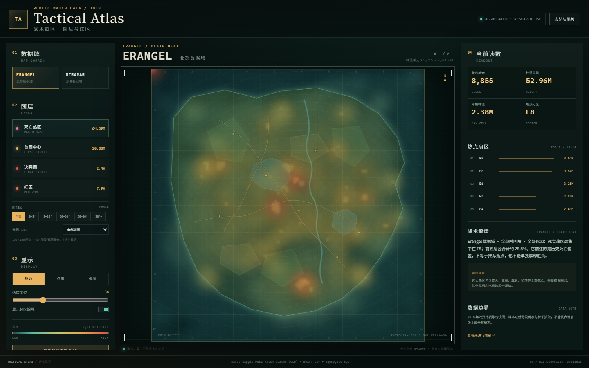

# Tactical Atlas · 战术热区

> 基于 PUBG 公开比赛数据的战术热区可视化网站：**圈层 / 红区 + 6500 万条死亡明细聚合**。
>
> 技术栈：原生 HTML + CSS + Canvas 2D，无框架、无构建、无外部请求。
>
> 本站部署在 `lhd257257-commits.github.io/tactical-atlas/`，与现有作品集首页共存；部署说明见 [`GITHUB_PAGES.md`](GITHUB_PAGES.md)。代码许可见 [`LICENSE`](LICENSE)，数据说明见 [`DATA_LICENSE.md`](DATA_LICENSE.md)。



---

## 1. 这是什么

一个可以切换 **ERANGEL / MIRAMAR** 两个数据域、查看 **死亡热区 / 首圈中心 / 决赛圈 / 红区** 四层热区、读取热点扇区与数据边界的交互式战术图册。

它不是 PUBG 官方地图，也不是实时对局工具；底图是**原创示意地图**，只保留 0—1000 的坐标空间、网格和分区编号。

## 2. 功能

- 两大地图数据域：ERANGEL、MIRAMAR；
- 四层图层：死亡热区（6500 万条死亡明细聚合）、首圈中心、决赛圈、红区；
- 死亡热区可按 **时间段（0—3′ / 3—10′ / 10—20′ / 20—30′ / 30′+）** 和 **死因（步枪/狙击/霰弹/载具/毒圈环境/其他）** 筛选；
- 热力 / 点阵 / 叠加三种显示；
- 热区半径可调；
- 10×10 分区（A1—J10）与热点 TOP 5；
- 悬停/点击查看单元权重、坐标、分区；
- 实时统计：聚合单元、权重总量、单格峰值、最热分区；
- 自动生成“战术解读”与“读图提示”；
- 导出当前视图 PNG；
- 方法与限制弹窗，标注数据来源、偏差和授权风险；
- 桌面三栏与移动端单列布局；移动端地图优先展示。

## 3. 运行

```bash
cd tactical-atlas
node serve.mjs
```

打开：

```text
http://127.0.0.1:4178/
```

不需要 `npm install`。也可用任意静态服务器指向本目录：

```bash
python -m http.server 4178 --directory tactical-atlas
```

> 不能直接双击 `index.html`：`fetch('./data/atlas.json')` 需要 HTTP。

## 4. 操作

| 操作 | 方式 |
|---|---|
| 切换地图 | 左侧 ERANGEL / MIRAMAR |
| 切换图层 | 死亡热区 / 首圈中心 / 决赛圈 / 红区 |
| 死亡筛选 | 时间段 + 死因 |
| 切换显示 | 热力 / 点阵 / 叠加 |
| 调整热区 | 热区半径滑块 |
| 查看单元 | 悬停地图；点击固定选中 |
| 重置 | 重置视图 |
| 导出 | 导出当前视图 PNG |
| 数据说明 | 顶部“方法与限制” |

快捷键：`1` Erangel，`2` Miramar，`Q/W/E` 圈层/红区，`H` 切换热力/点阵，`Esc` 取消选中。

## 5. 数据

### 来源

- Kaggle: [PUBG Match Deaths and Statistics](https://www.kaggle.com/datasets/skihikingkevin/pubg-match-deaths)，页面标注 **CC0: Public Domain**。
- 聚合 SQL 快照：[zcyoop/pubg_data_analysis / pubg.sql](https://github.com/zcyoop/pubg_data_analysis/blob/master/pubg.sql)。
- 参考仓库：[KaiserW/pubg-data](https://github.com/KaiserW/pubg-data)。

### 处理

1. **圈层/红区**：`tools/build_tactical_data.py` 从 SQL 快照解析三张聚合表，输出 `atlas.json`：

| 表 | 含义 | 行数（本项目） |
|---|---|---:|
| `first_circle` | 首圈中心落点计数 | 15,030 |
| `zc_lastpoisoncircle` | 最后毒圈中心落点计数 | 2,000 |
| `zk_redzone` | 红区落点计数 | 2,063 |

2. **死亡热区**：完整 Kaggle 数据集下载为约 **4.4GB zip / 9.75GB 死亡 CSV**；用 DuckDB 分块扫描 5 个 `kill_match_stats_final_*.csv`，按地图 × 时间段 × 死因 × 100×100 网格聚合，输出 `deaths.json`：

| 项 | 数值 |
|---|---:|
| 死亡记录总权重 | **64,586,279** |
| ERANGEL 死亡 | 52,963,725 |
| MIRAMAR 死亡 | 11,622,554 |
| 聚合行数 | 286,070 |
| `deaths.json` | 约 3.1MB |
| 网格 | 100×100 |

页面首次点击“死亡热区”才懒加载 `deaths.json`，不拖慢初始圈层页。

### 数据边界

- 2018 年数据，不代表当前版本；
- 原始抓取以低分段玩家为种子，样本有偏差；
- 聚合口径无法完全核验；页面只称“权重”；
- 热区是空间频率，不是因果结论；
- 死亡热区包含交火、毒圈、载具、坠落等所有死亡，不能直接当“推荐落点”；
- 地图为原创示意，不是 PUBG 官方地图。

## 6. 目录

```text
tactical-atlas/
├─ index.html
├─ styles.css
├─ src/app.js             Canvas 地图/热区/交互
├─ data/atlas.json        圈层/红区聚合数据
├─ data/deaths.json       65M 死亡明细的 100×100 聚合
├─ serve.mjs              静态服务器（4178）
├─ shots/                 桌面/移动/图层截图
├─ docs/
│  ├─ 01_数据与图表说明.md
│  └─ 02_本次工作说明.md   完整工作记录
├─ README.md
└─ ATTRIBUTION.md         数据与 IP 说明
```

## 7. 测试

从项目根目录（需要根目录的 `puppeteer-core`）：

```bash
node tools/atlas_shot.mjs
node tools/atlas_death_test.mjs
```

已实际验证：

- 页面加载、圈层默认视图；
- 切换 Miramar + 红区；
- 悬停 tooltip 显示 `F6 / 157 权重 / X 548 / Y 553`；
- **死亡热区**加载 64.59M 权重，ERANGEL 8,855 个合并单元；
- 死亡筛选 `0—3′ + 步枪` 得到 3.00M 权重；
- 无 console/page error、无 404；
- 桌面 1440×900 与移动端 390×844 截图。

## 8. 限制

- 死亡热区是 **100×100 网格**，不是逐点热图；不能精确报点；
- 死因是关键词分类，不是官方武器分类；未按枪械逐项拆分；
- 没有队伍/模式/玩家排名过滤；
- 底图是示意，不能用于精确报点；
- 无后端、无数据库、无实时 API；
- 2018 年数据，不能代表当前版本；
- 公开/商用前必须处理数据来源、PUBG 商标/地图 IP 与仓库无 LICENSE 的问题。

## 9. 二次开发建议

1. 接入自己的聚合数据：保持 `atlas.json` 结构（`maps[map].layers[layer] = [[x,y,n],...]`）。
2. 加入筛选：time、killed_by、victim_placement、match_id（需要原始 death CSV）。
3. 加入区域详情：点击扇区后显示 top cells、峰值、样本量。
4. 换成自己的地图底图：修改 `MAP_STYLES`，不要直接使用官方地图。
5. 做服务端预聚合：大数据不要全部塞进浏览器；用 DuckDB/ClickHouse 预计算。
